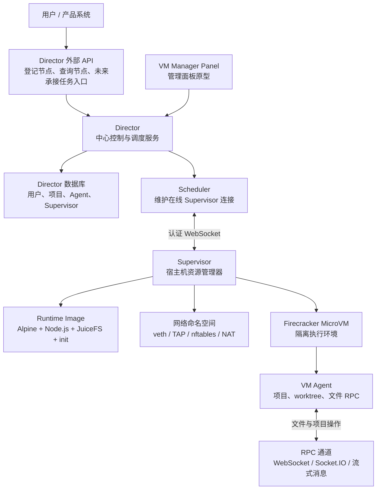
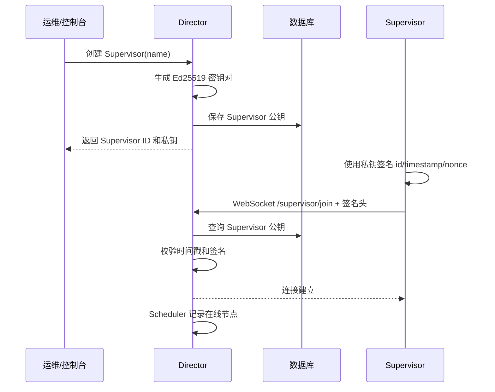
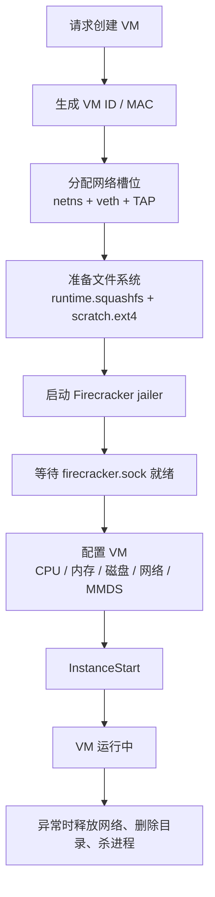
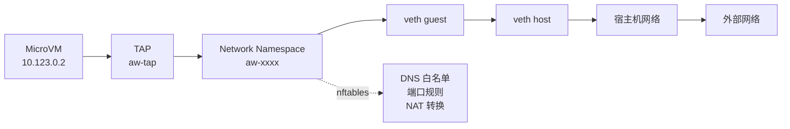

# Agent Worker

Agent Worker 是一套用于运行 AI Agent 工作任务的隔离执行基础设施。它的目标不是直接提供一个聊天界面，而是为上层产品提供“可以安全创建、调度、运行、观察和回收 Agent 工作环境”的底座。

简单理解：当一个 AI Agent 需要处理代码仓库、读写文件、执行命令、联网访问依赖或进行较长时间任务时，Agent Worker 会为它准备一个独立的运行空间。这个空间运行在 Firecracker MicroVM 中，拥有单独的文件系统、网络、CPU/内存限制和可认证的控制通道，从而降低不同任务、不同用户、不同项目之间相互影响的风险。

## 解决什么问题

在实际产品中，AI Agent 往往不只是“回复一句话”。它可能需要：

- 拉取或维护一个项目代码仓库。
- 创建一个临时工作分支，修改文件并运行测试。
- 执行用户或模型生成的命令。
- 安装依赖、访问网络、读写中间文件。
- 保留任务会话状态，方便继续跟进或审计。

如果所有任务都直接运行在同一台服务器上，会遇到几个核心风险：

- **安全隔离不足**：一个任务可能读取或破坏另一个任务的数据。
- **资源不可控**：某个 Agent 可能占满 CPU、内存或网络。
- **环境不可复现**：不同任务污染同一个运行环境，排查困难。
- **调度困难**：多台宿主机上的可用容量、连接状态和任务生命周期难以统一管理。

Agent Worker 的设计就是把这些问题拆开：Director 负责登记和调度，Supervisor 负责管理宿主机资源，MicroVM 负责隔离执行，VM Agent 负责在隔离环境内提供文件和项目操作能力。

## 典型场景

### 场景一：产品里的“代码修复 Agent”

用户提交一个需求：“修复登录页在移动端按钮错位的问题”。上层产品可以为这个任务创建一个项目会话，Agent Worker 在后台创建隔离 VM，Agent 在会话工作区里修改代码、运行测试，完成后把变更结果交给产品侧展示。

用户看到的是“Agent 正在处理任务”，而底层实际发生的是：创建会话、分配运行节点、启动 MicroVM、挂载工作区、通过 RPC 操作文件、最后回收资源。

### 场景二：多租户 Agent 平台

不同客户的项目不能共享文件系统，也不能互相访问内部服务。Agent Worker 通过 Firecracker、网络命名空间、nftables 规则和独立 worktree，把不同项目、不同会话拆到各自的边界内。

### 场景三：临时实验环境

需求人员希望让 Agent 临时分析一个项目、生成改造建议或跑一段验证脚本。Agent Worker 可以创建一个可丢弃的 scratch 文件系统，任务结束后直接销毁，避免污染长期环境。

## 整体架构



### 角色分工

| 模块 | 面向产品的解释 | 当前代码中的职责 |
| --- | --- | --- |
| Director | 中央调度台 | 提供 HTTP API、管理 Supervisor 注册信息、校验 Supervisor 身份、维护在线连接 |
| Supervisor | 每台宿主机上的执行节点 | 下载 Firecracker 组件、构建运行镜像、准备网络、创建 MicroVM |
| MicroVM | 每个任务的隔离房间 | 运行只读 runtime 镜像和可写 scratch 文件系统，限制 CPU/内存 |
| VM Agent | 房间里的执行助手 | 管理项目仓库、worktree、文件读写 RPC、隧道连接 |
| RPC | 控制线 | 在服务与 VM Agent 之间传递方法调用、错误、取消和流式数据 |
| VM Manager | VM 管理能力包 | 较早期/独立的 VM 控制封装，包含 VM 生命周期、SSH 终端和网络管理 |
| VM Manager Panel | 可视化管理原型 | Next.js 页面，目前主要展示环境状态 |

## 核心机制

### 1. Supervisor 注册与认证

Director 对外提供 Supervisor 创建接口。创建时会生成 Ed25519 密钥对：

- 公钥保存到 Director 数据库。
- 私钥返回给 Supervisor，由部署方安全保存。

Supervisor 连接 Director 时，会在 WebSocket 握手请求头中带上：

- `x-supervisor-id`
- `x-timestamp`
- `x-nonce`
- `x-signature`

签名内容是 `supervisor id + 时间戳 + 随机数`。Director 会检查时间窗口、查询公钥并验证签名，防止未授权节点接入和重放攻击。



### 2. MicroVM 启动流程

Supervisor 创建 VM 时，会做几件事：

1. 生成 VM ID，并基于 ID 派生稳定 MAC 地址。
2. 从网络槽位池中分配一个独立网络命名空间。
3. 准备 Firecracker jailer、kernel、runtime 镜像和 scratch 磁盘。
4. 使用 cgroup 设置 CPU 和内存上限。
5. 配置 Firecracker：网络、MMDS 元数据、vsock、启动参数和磁盘。
6. 启动实例，并返回 VM 的 ID、IP、根目录和控制句柄。



### 3. 文件系统设计

VM 内部的启动脚本会挂载基础系统目录，并把写入空间放在 scratch 盘上：

- `runtime.squashfs`：只读运行镜像，包含 Node.js、curl、bubblewrap、JuiceFS 等基础能力。
- `scratch.ext4`：每个 VM 独立的可写临时磁盘。
- JuiceFS 临时本地后端：当前用于在 scratch 上构建可挂载的工作区基础。
- `bubblewrap`：在 VM 内进一步限制应用进程能看到的目录。

这使得运行环境可以快速复制、任务写入可以被单独丢弃，且基础镜像不会被 Agent 修改。

### 4. 网络隔离与访问控制

每个 VM 使用独立网络槽位。Supervisor 会为槽位创建：

- Linux network namespace。
- 一对 veth 设备，连接宿主机和命名空间。
- TAP 设备，连接 Firecracker VM。
- nftables 规则，控制转发、NAT、DNS 和端口访问。

当前策略允许常见出网能力，例如 DNS、ICMP、SSH、HTTP、HTTPS，同时阻断非白名单 DNS，并禁止同一 TAP 内部直接互通。



### 5. 项目与会话 worktree

VM Agent 中的项目模块会在本地维护一个 bare Git 仓库，并基于它创建 worktree：

- `main` worktree：项目主工作区。
- `session/<id>` worktree：某个任务或会话的独立工作区。

这样，Agent 可以在会话分支中修改文件，不直接污染主线。产品上可以把一次 Agent 工作理解为“围绕某个项目创建的一次可追踪会话”。

### 6. RPC 通信机制

`@aw/rpc` 是项目内的轻量 RPC 包。它提供：

- 方法定义：用 schema 描述输入输出。
- 普通请求：适合列表、移动、删除等一次性操作。
- 服务端流：适合读文件等大内容传输。
- 取消机制：远端取消请求时会传播 abort 信号。
- 错误传递：把远端错误编码后传回调用方。

VM Agent 当前注册了 `vm-agent.fs` 文件服务，支持：

- `list`：列目录。
- `metadata`：读取文件或目录元信息。
- `read`：流式读取文件。
- `copy`：复制文件。
- `move`：移动文件。
- `remove`：删除文件或目录。

这些操作都会检查目标路径是否在对应 worktree 内，避免通过 `../` 访问工作区外的文件。

## 代码结构

```text
.
├── services
│   ├── director          # 中央控制服务：API、认证、调度、数据库
│   ├── supervisor        # 宿主机执行节点：镜像、网络、Firecracker 编排
│   └── runner            # 预留的任务 runner 服务，目前基本为空
├── packages
│   ├── rpc               # 自研 RPC 协议与 WebSocket 适配
│   ├── vm-agent          # VM 内/项目侧 Agent 运行时：worktree、文件 API、隧道
│   ├── vm-manager        # 独立 VM 管理封装：生命周期、网络、SSH 终端
│   ├── vm-manager-panel  # Next.js 管理面板原型
│   └── shared-config-typescript
│       └── ...           # 共享 TypeScript 配置
├── package.json          # monorepo 脚本
├── pnpm-workspace.yaml   # pnpm workspace 配置
└── turbo.json            # Turborepo 任务配置
```

### Director 目录重点

```text
services/director/src
├── bootstrapper.ts              # 启动顺序：变量、环境、数据库、HTTP、路由、调度
├── external-router.ts           # 对外 API 路由
├── internal-router-handler.ts   # Supervisor WebSocket 接入点
├── core/services
│   ├── authenticator.ts         # Supervisor 签名认证
│   └── scheduler.ts             # 在线 Supervisor 连接管理
├── endpoints/supervisor         # 创建、列表、删除 Supervisor API
└── supports/database/schema     # 用户、项目、Agent、Supervisor 等表结构
```

### Supervisor 目录重点

```text
services/supervisor/src
├── internal/director.ts         # 连接 Director，并在握手中签名认证
├── internal/orchestrator.ts     # 创建 Firecracker MicroVM
├── internal/network.ts          # 网络命名空间、veth、TAP、nftables
├── internal/image.ts            # 构建 runtime.squashfs 和 scratch.ext4
├── internal/controller.ts       # Director 调用 Supervisor 的控制面，当前接口未完全实现
└── resources
    ├── init.sh                  # VM PID 1 启动脚本
    └── app/index.js             # VM 内示例 Node 应用，读取 MMDS 元数据
```

### VM Agent 目录重点

```text
packages/vm-agent/src
├── bootstrapper.ts              # 初始化环境、项目、worktree、RPC server、隧道
├── internal/project.ts          # 初始化 bare Git 仓库
├── internal/worktree.ts         # main/session worktree 管理
├── api/protocol/fs.ts           # 文件 API 协议定义
├── api/implementation/fs.ts     # 文件 API 实现
└── api/index.ts                 # 注册 RPC 服务并绑定 WebSocket
```

## 数据模型概览

Director 侧数据库已经体现了产品目标：

- `users`：用户。
- `agents`：Agent 定义，包括名称、描述、模板包 ID、记忆库 ID。
- `agent_env_variables`：Agent 环境变量。
- `projects`：项目，包含所属 Agent、镜像 ID、资源规格、归档状态。
- `project_members`：项目成员。
- `project_sessions`：项目会话。
- `supervisors`：可接入的宿主机节点。

这些表说明 Agent Worker 计划承载的不只是“启动一台 VM”，而是围绕用户、项目、Agent、会话和执行节点形成完整运行系统。

## 运行与开发

本仓库使用 pnpm workspace 和 Turborepo。

```bash
pnpm install
pnpm build
pnpm test
```

常用开发命令：

```bash
pnpm --filter @aw/vm-director dev
pnpm --filter @aw/vm-supervisor dev
pnpm --filter @aw/vm-agent dev
```

Director 默认监听：

```text
http://127.0.0.1:3008
```

开发环境下提供 OpenAPI/Scalar 页面：

```text
http://127.0.0.1:3008/api/scalar
```

### 关键环境变量

| 变量 | 作用 | 默认值 |
| --- | --- | --- |
| `AW_DIRECTOR_ROOT_DIR` | Director 工作目录 | `~/.aw-director` |
| `AW_DIRECTOR_HTTP_HOST` | Director 监听地址 | 未设置时监听所有接口 |
| `AW_DIRECTOR_HTTP_PORT` | Director 监听端口 | `3008` |
| `AW_SUPERVISOR_ROOT_DIR` | Supervisor 工作目录 | `~/.aw-supervisor` |
| `AW_SUPERVISOR_ID` | Supervisor UUID | 无，必须配置 |
| `AW_SUPERVISOR_PRIVATE_KEY` | Supervisor 私钥 | 无，必须配置 |
| `AW_SUPERVISOR_DIRECTOR_HOST_URL` | Director WebSocket 地址 | 无，必须配置 |
| `VM_AGENT_ROOT_DIR` | VM Agent 工作目录 | `~/.agent-worker` |
| `VM_AGENT_REGISTRY_URL` | VM Agent 注册/隧道服务地址 | 代码中临时写入 `http://localhost:3000` |
| `VM_AGENT_REGISTRY_AUTH_TOKEN` | VM Agent 注册令牌 | 代码中临时写入 `token` |

### 系统依赖

Supervisor/VM 相关能力依赖 Linux 虚拟化与网络能力，通常需要：

- Firecracker 和 jailer。
- Linux kernel image。
- `sudo` 权限。
- `iproute2`、`nftables`、`buildah`、`qemu-utils`、`e2fsprogs`、`squashfs-tools` 等系统工具。
- 支持 cgroup v1 或 v2。

代码会在 Supervisor 初始化时下载 Firecracker、jailer 和 kernel，并使用 buildah 构建 Alpine runtime 镜像。

## 当前实现状态

这个仓库处在基础设施搭建阶段，部分模块已经具备完整骨架，部分接口仍是预留状态：

- Director 已实现启动、外部 API、Supervisor 创建、Supervisor WebSocket 认证和在线连接登记。
- Supervisor 已实现环境初始化、Firecracker 资源准备、runtime 镜像构建、网络槽位、MicroVM 创建。
- Supervisor 的控制器接口中 `host.status`、`task.dispatch`、`task.inspect`、`task.terminate` 目前仍是 `Unimplemented`。
- VM Agent 已实现项目/worktree 初始化、文件 RPC 协议和文件操作实现。
- Runner 服务目前为空实现。
- VM Manager Panel 目前是管理面板原型，仅展示环境状态。

## 一句话总结

Agent Worker 是一个面向 AI Agent 产品的隔离执行底座：Director 管调度，Supervisor 管宿主机，Firecracker 提供安全边界，VM Agent 管项目与文件操作。它让上层产品可以把“让 Agent 去做一件事”落到一个可认证、可隔离、可限制、可回收的运行会话中。
